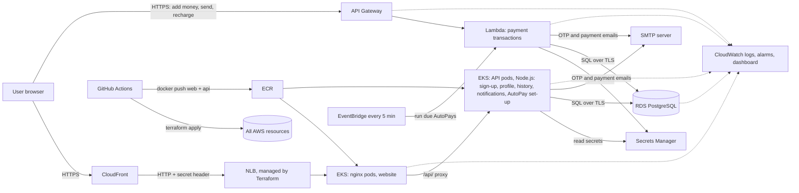

# PayWave - Paytm-style digital wallet on AWS + Kubernetes

A wallet app with **everything created and deployed by one GitHub Actions pipeline**. You provide credentials as GitHub secrets, push to `main`, and the pipeline builds the infrastructure with Terraform, deploys the website **and the API service to Kubernetes (EKS)**, deploys the **payment transactions to AWS Lambda**, and prints the public URL.

Features: sign up with **mobile number** (your payment ID) and email OTP, add money to your wallet **in one tap (no card needed)**, your own **virtual debit and credit card** (used only when you choose to pay someone with a card), send money by mobile number, **QR code to receive** and a **scanner** to pay, **profile photo**, **mobile recharge**, **AutoPay** (daily, weekly, monthly), and a **notification to both sender and receiver on every payment** (in-app bell plus email).



**Who does what.** Kubernetes runs the website (nginx) and the API service (`ROUTE_MODE=core`): `/auth/*`, `/me`, `/lookup`, `/transactions`, `/insights`, `/contacts`, `/profile/*`, `/avatar`, `/notifications*`, `/autopay*`. Lambda runs only the routes that move money (`ROUTE_MODE=payments`): `POST /wallet/add-money`, `POST /wallet/transfer`, `POST /wallet/recharge`, plus the scheduled AutoPay runner. Both use the same code base, database and signing key, so a login token from one is accepted by the other. The browser calls `/api/...` (same origin, proxied by nginx to the API pods) and calls API Gateway directly for payments (`PAYMENTS_API_URL` in `config.js`).

| Technology | What it does here |
|---|---|
| Terraform | Creates VPC, EKS, RDS, Lambda, API Gateway, EventBridge, S3, ECR (2 repos), IAM, Secrets, CloudWatch (`terraform/`) |
| Kubernetes (EKS) | Website: Deployment x2, NodePort Service (reached through CloudFront; no Kubernetes-created load balancer). API service: Deployment x2, ClusterIP Service, HPA, PodDisruptionBudget, IRSA service account |
| AWS Lambda + API Gateway | Payment transactions (add money, transfer, recharge) and the 5-minute AutoPay runner |
| Amazon RDS PostgreSQL | Users, wallets, transactions, notifications, AutoPay. Private subnets, encrypted, reachable only from Lambda and the EKS nodes |
| AWS IAM | Least-privilege roles for Lambda and for the API pods (IRSA): each reads exactly 2 secrets |
| Secrets Manager | DB password (RDS-managed, auto-rotated), JWT key and SMTP credentials |
| Amazon S3 | Versioned private bucket with the built frontend/static files |
| CloudWatch | Log groups, 7 alarms to an SNS email topic, one dashboard, EKS control plane logs |
| SMTP | Sign-up verification code and payment notification emails (Gmail, SES, SendGrid, anything SMTP) |
| Prometheus + Grafana | Metrics, dashboards and alert rules on the cluster (`k8s/monitoring/`, Helm `kube-prometheus-stack`) |
| GitHub Actions | `deploy.yml` (full deploy on push), `ci.yml` (PR checks), `destroy.yml` (manual tear down), `otp.yml` (manual: show sign-up codes when SMTP is not set) |

## Deploy in 5 steps

1. **Create a GitHub repository** and push this folder to it (branch `main`).
2. **Create an AWS access key** for an IAM user in a dedicated or sandbox AWS account. `AdministratorAccess` is the simplest, because the pipeline creates VPCs, IAM roles, EKS and more.
3. **Add repository secrets** under *Settings > Secrets and variables > Actions > Secrets*:

   | Secret | Required | Example |
   |---|---|---|
   | `AWS_ACCESS_KEY_ID` | yes | `AKIA...` |
   | `AWS_SECRET_ACCESS_KEY` | yes | |
   | `SMTP_HOST` | for real emails | `smtp.gmail.com` |
   | `SMTP_PORT` | no (default 587) | `587` or `465` |
   | `SMTP_USER` | for real emails | `you@gmail.com` |
   | `SMTP_PASSWORD` | for real emails | Gmail *App Password* (needs 2-step verification) |
   | `SMTP_FROM` | for real emails | `PayWave <you@gmail.com>` |
   | `ALERT_EMAIL` | no | where CloudWatch alarms are sent (confirm the AWS email) |
| `GRAFANA_ADMIN_PASSWORD` | no | Grafana login password for user `admin` (if empty, a random one is generated, see *Monitoring*) |

   Optional variables *(Variables tab)*: `AWS_REGION` (default `us-east-1`), `KPS_VERSION` (kube-prometheus-stack Helm chart version, default `93.6.1`).
   Without SMTP secrets the stack still works, but the sign-up codes (OTP) are not emailed: the API pods write them to their log. Run **Actions > Show sign-up codes > Run workflow** right after you press *Register* to read the latest codes (valid 10 minutes), or `kubectl -n paywave logs -l app=paywave-api | grep OTP`. Testing only; configure SMTP for real use.
4. **Push to `main`** (or run *Actions > Deploy PayWave > Run workflow*). The first run takes about 25-35 minutes (EKS and RDS are slow to create).
5. **Open the job summary**: it shows the app URL (`https://<id>.cloudfront.net`), the API URL and the CloudWatch dashboard. A new CloudFront distribution needs a few minutes to roll out, so the first smoke test can take up to 20 minutes. Register, enter the emailed code, add money, send money.

What the pipeline does, in order: unit tests (backend and QR code), build the Lambda zip, create the Terraform state bucket (first run), `terraform apply`, build and push the **web and API images** to ECR, sync static files to S3, deploy the API and web pods to EKS, then smoke-test the payments Lambda, the API pods (this also runs the DB migrations) and the website, and finally install **Prometheus + Grafana** on the cluster.

**Push = deploy, destroy = manual.** `deploy.yml` runs on every push to `main` (except Markdown-only changes). `destroy.yml` has only a manual trigger: *Actions > Destroy PayWave > Run workflow*, then type `DESTROY`. It never runs on push.

## Monitoring (Prometheus + Grafana)

The deploy installs the `kube-prometheus-stack` Helm chart into the `monitoring` namespace (`scripts/deploy-monitoring.sh`, values in `k8s/monitoring/`).

- **Prometheus** scrapes the cluster (nodes, pods, kube-state-metrics) and the PayWave API pods, which expose `/metrics` on internal port 9100 (request count, latency histogram, in-flight requests, memory, CPU, event-loop lag). That port is not reachable through the public `/api/` proxy.
- **Grafana has its own AWS load balancer** (a Network Load Balancer, plain HTTP). After the deploy, open the job summary (*Actions > the run > Summary > Monitoring (Grafana)*): it shows the Grafana address `http://<name>.elb.<region>.amazonaws.com`, the user `admin` and the password (your `GRAFANA_ADMIN_PASSWORD` secret, or a generated one printed there, so keep the repository private). A brand-new load balancer needs 2-5 minutes before the address answers.
- **Dashboards** (Grafana left menu > Dashboards > folder **PayWave**). The number in each name tells you the order to look at them:

  | Dashboard | What it monitors | Data from |
  |---|---|---|
  | **1. Website and API Health (Kubernetes)** | Are the website API pods up, requests per second, failed requests, response time, memory/CPU of each API pod, restarts | Prometheus |
  | **2. Payments, Lambda, API Gateway and Database (AWS)** | Money transfers, card top-ups, recharge and AutoPay (Lambda calls, errors, time), the API Gateway front door, the PostgreSQL database (CPU, connections, free disk) | CloudWatch (IRSA role with `CloudWatchReadOnlyAccess`) |
  | **3. Servers and Pods (Kubernetes cluster)** | CPU, memory, disk and network of the EKS servers, how many pods run, pods stuck Pending | Prometheus |

  Every dashboard starts with a "What am I looking at?" box, and hovering the small *i* on a panel explains it and says what a healthy value is. The standard Kubernetes dashboards from the chart are also there. Add your own JSON in `k8s/monitoring/dashboards/`.
- **Alert rules** (`k8s/monitoring/rules.yaml`): API down, 5xx above 5%, p95 latency above 1 s, pod restarts. Alertmanager is off, so they show in *Grafana > Alerting*; the emailed alarms remain the CloudWatch ones.
- **No persistent storage**: Prometheus keeps 7 days in memory-backed pod storage, so history resets if the pod restarts. This avoids the EBS CSI driver and leaves nothing behind on destroy.
- If monitoring fails to install, the deploy still succeeds (the app is live); you get a warning and can re-run the workflow.
- Grafana is reachable from the internet over plain HTTP behind its login. Set a strong `GRAFANA_ADMIN_PASSWORD` secret, and keep the repository private if you let the pipeline generate the password. If Grafana does not open: check the *Deploy monitoring* step log (it prints pod status and events on failure) and that the `monitoring-grafana` Service has an external hostname (`kubectl -n monitoring get svc monitoring-grafana`).
- To look at Prometheus itself: `kubectl -n monitoring port-forward svc/monitoring-kube-prometheus-prometheus 9090`.

## Features and how they work

- **Mobile number is the payment ID.** Sign-up asks for an Indian mobile number (10 digits starting 6-9, `+91`/`0` prefixes accepted). It is unique among verified accounts, shown on the balance card (Copy number, Copy pay link) and used to pay: `https://<site>/#pay=9876543210` opens Send with the number filled in. The old `PW...` ID still exists internally (`users.pay_id`) and is accepted by the API. Accounts created before this version are asked to add a number in their profile (it can be set once).
- **Add money needs no card.** *Add money* asks for an amount only (with ₹500 / ₹1,000 / ₹2,000 / ₹5,000 quick buttons) and credits your own wallet. It is simulated: no gateway is called and nothing is charged to anyone.
- **Your own debit and credit card.** Every account gets two virtual cards, issued when the email is verified (existing accounts get them the first time they open *My cards* or *Send*). The **debit card** spends your wallet balance. The **credit card** has a ₹25,000 limit; spending raises the amount you owe, and *Pay bill* repays it from the wallet. Numbers are 16 digits and pass the Luhn check, the expiry is 5 years out, and the 3 digit CVV is random. The full number and CVV are encrypted in the database (AES-256-GCM, key derived from the app secret) and are shown only after you re-enter your password, hiding again after 30 seconds. You can freeze and unfreeze a card (unfreezing needs the password), and five wrong CVVs in a row freeze it. They are demo cards: no real card network is involved.
- **Card details are asked for only when you pay a person with a card.** *Send* defaults to **Wallet** and asks for nothing extra. If you pick the debit or credit card, you enter that card's CVV. The CVV is checked on the server before any money moves; a credit card payment cannot exceed the available limit, even with many payments at once (card rows are locked before wallet rows, so there are no deadlocks).
- **QR and scanner.** My QR draws a QR code of your pay link (download as PNG, copy, share). The scanner reads codes from the camera (needs HTTPS, or `localhost`) or from a photo/upload (works over plain HTTP; on a phone it opens the camera app). The encoder and decoder are in `frontend/public/qr.js` with no dependencies.
- **Profile photo.** Cropped and resized to 256x256 JPEG in the browser, stored as a small data URL, shown next to your name and in "Send again".
- **Mobile recharge (simulated).** Pick operator, plan or amount (Rs 10 to 3,000); your wallet is debited and a `RECHARGE` transaction is recorded. No operator is contacted.
- **AutoPay.** Schedule a payment to a mobile number or a recharge, daily/weekly/monthly (max 10). EventBridge invokes the Lambda every 5 minutes; due items run with a deterministic idempotency key, so an overlapping or retried run can never pay twice. If the balance is too short the run is skipped, you get a failure notification, and the next date is scheduled. Missed runs are not caught up.
- **Notifications.** Every payment writes an in-app notification for the sender and the receiver in the same database transaction as the money movement, and queues an email to both (sent best-effort after commit; a slow SMTP server never fails a payment). The bell polls every 25 seconds and shows a toast for new items. Recharges, top-ups and AutoPay failures notify you too. Gmail free accounts cap daily sending, and each transfer sends 2 emails.

## Repository layout

```
terraform/   VPC, EKS (+IRSA), RDS, Lambda, API Gateway, EventBridge, CloudFront + NLB, S3, ECR, IAM, Secrets, CloudWatch
backend/     API code (src/), SQL migrations, tests, Dockerfile + server.js (Kubernetes), Lambda entry src/index.js
frontend/    Web app (public/: core.js, panels.js, app.js, qr.js), nginx.conf (/api proxy), Dockerfile, QR tests
k8s/         Namespace, web (ConfigMap, Deployment, NodePort Service, HPA, PDB), api.yaml (ServiceAccount, Deployment, ClusterIP Service, HPA, PDB)
k8s/monitoring/  Prometheus + Grafana Helm values, ServiceMonitor, alert rules, dashboards (JSON)
scripts/     build-lambda.sh, bootstrap-state.sh, deploy-k8s.sh, deploy-monitoring.sh, destroy.sh
.github/workflows/   deploy.yml, ci.yml, destroy.yml
docker-compose.yml   Local run: Postgres + mail catcher + API + web
```

## API

All bodies are JSON. Errors look like `{"error":{"code":"INSUFFICIENT_FUNDS","message":"..."}}`.

Where each route runs: **Lambda** = payments, **K8s** = API pods.

| Method and path | Runs on | Auth | Purpose |
|---|---|---|---|
| `GET /health` (`?deep=1` checks the DB) | both | no | Liveness |
| `POST /auth/register` `{fullName,mobile,email,password}` | K8s | no | Creates account, emails a 6 digit code (409 `MOBILE_TAKEN` if the number belongs to a verified account) |
| `POST /auth/verify-otp` `{email,otp}` | K8s | no | Verifies email, returns `{token,user}` |
| `POST /auth/resend-otp` `{email}` | K8s | no | New code (60 s cooldown) |
| `POST /auth/login` `{email,password}` | K8s | no | Returns `{token,user}` (1 hour JWT) |
| `GET /me` | K8s | Bearer | Profile (mobile, avatar) and balance |
| `GET /lookup?to=<mobile>` | K8s | Bearer | Name behind a number, so the sender can confirm before paying |
| `POST /wallet/add-money` `{amount}` | **Lambda** | Bearer | Add money to your own wallet, no card (Rs 1 to 50,000, simulated) |
| `GET /cards` | Kubernetes | Bearer | Your debit and credit card (masked), credit limit and amount owed |
| `POST /cards/reveal` `{kind,password}` | Kubernetes | Bearer | Full number, expiry and CVV (password re-check) |
| `POST /cards/status` `{kind,frozen,password?}` | Kubernetes | Bearer | Freeze or unfreeze a card (unfreeze needs the password) |
| `POST /cards/repay` `{amount}` | **Lambda** | Bearer | Pay the credit card bill from the wallet |
| `POST /wallet/transfer` `{to,amount,note?}` | **Lambda** | Bearer | Send money by mobile number (Rs 1 to 1,00,000) |
| `POST /wallet/recharge` `{mobile,operator,amount,plan?}` | **Lambda** | Bearer | Mobile recharge, simulated (Rs 10 to 3,000) |
| `GET /transactions?limit=&before=` | K8s | Bearer | History, newest first, cursor paging |
| `GET /insights`, `GET /contacts` | K8s | Bearer | 30 day totals and 7 day series; people you paid recently |
| `POST /profile/mobile`, `POST /profile/avatar`, `POST /profile/avatar/remove`, `GET /avatar?to=` | K8s | Bearer | Set number once; photo upload/removal; read a photo |
| `GET /notifications`, `POST /notifications/read` | K8s | Bearer | List with unread count; mark read |
| `GET /autopay`, `POST /autopay`, `POST /autopay/action` | K8s | Bearer | List, create, pause/resume/cancel |
| *(scheduled)* EventBridge every 5 minutes | **Lambda** | n/a | Runs the due AutoPays |

Money endpoints accept an optional `Idempotency-Key` header, so a retried request never moves money twice.

Safety built in: scrypt password hashes, constant-time comparisons, 5 OTP attempts per code, account lock after 5 failed logins, identical response for registered and unregistered emails, amounts handled as integer paise (no floating point), row locks in a fixed order so opposite transfers cannot deadlock, a CHECK constraint that keeps balances non-negative.

## Run locally

```bash
docker compose up --build
# App http://localhost:8081   API http://localhost:3000/health   Emails http://localhost:8025
# (locally one process serves all routes; in AWS they are split between Kubernetes and Lambda)
cd backend && npm test                  # unit tests, no dependencies needed
node --test frontend/test/*.test.js     # QR encoder/decoder tests
```

## Cost warning

This is a real EKS + NAT + RDS stack. Rough estimate: **about $235-285 per month (~$0.35 per hour)** in `us-east-1`: EKS control plane ~$73, three `t3.medium` nodes ~$90 (a third node was added for Prometheus/Grafana), NAT gateway ~$35, one NLB behind CloudFront ~$17 and one NLB for Grafana ~$17 (CloudFront itself is ~free at demo traffic), RDS `db.t3.micro` ~$15-20, the rest is small. Run **Actions > Destroy PayWave** (type `DESTROY`) when you are done. The Terraform state bucket (`paywave-tfstate-<account>-<region>`) is kept on purpose; delete it by hand if you want it gone.

## Before this handles real money

This is a working demo, not a licensed payment product.

- **Add money, the virtual cards and recharges are simulated.** A real wallet must credit money only after a payment gateway (UPI, cards) confirms it by signed webhook, must call a recharge aggregator for recharges, and in India needs RBI Prepaid Payment Instrument authorisation, KYC and audit controls.
- **Mobile numbers are not verified by SMS.** Someone could register a number that is not theirs before the real owner does. Real products verify by OTP to the number (SMS in India needs DLT registration) before allowing payments to it.
- **The camera scanner needs HTTPS.** Photo/upload scanning works on plain HTTP; live camera does not (browser rule).
- **The address is a `*.cloudfront.net` name.** It is HTTPS already (CloudFront's certificate). For your own domain, add an ACM certificate in `us-east-1` and an alias on the distribution, then set `cors_allowed_origin` to that domain. The load balancer behind CloudFront is plain HTTP inside AWS and refuses any request that lacks CloudFront's secret header.
- Other hardening to consider: AWS WAF on API Gateway, RDS Proxy and Multi-AZ (`db_multi_az = true`), `db_deletion_protection = true`, one NAT gateway per AZ, pinning the RDS CA bundle in `backend/src/db.js`, GitHub OIDC instead of long-lived AWS keys, a private EKS endpoint with a self-hosted runner.
- The pipeline user becomes EKS cluster admin. If you later deploy with a different AWS identity, add it with an EKS access entry.

## Verification status

Tested in a sandbox (no AWS account was available there):

- **Backend:** 43 unit tests pass. A full run against a real **PostgreSQL 16**, with the Kubernetes-mode and the Lambda-mode API side by side, passed 41 checks: card issue (Luhn-valid numbers, encrypted at rest), password-protected reveal, add money with no card, sending from the wallet with no card, debit and credit card payments (wrong, missing and right CVV, idempotent replay), credit limit, freeze/unfreeze, auto-freeze after 5 wrong CVVs, bill payment, history, existing accounts getting cards on first visit, **10 parallel credit payments against the limit (exactly the right number succeed)**, a mixed parallel run with no deadlocks, and ledger checks. Migration 004 was also applied on top of a database with migrations 001-003 and existing rows.
- **Frontend:** 8 QR tests pass. The real web app code was driven in a simulated browser (jsdom) against the real backend: add money with no card fields, the Cards panel (masked, reveal with password, hide), Send defaulting to Wallet with the CVV field appearing only when a card is chosen, a credit card payment, paying the bill, and the history, with zero JavaScript errors.
- **nginx:** the real `nginx.conf` was run: direct requests without CloudFront's secret header get 403 (a wrong header and a suffix trick too), `/healthz` stays open, `/api` is proxied.
- **Kubernetes:** all manifests, including the Prometheus ServiceMonitor and alert rules, pass strict schema validation (kubeconform). Shell scripts pass ShellCheck.
- **Terraform:** formatted and parsed; the module outputs and provider arguments used by `cloudfront.tf` were checked against the module source and the AWS provider docs. **`terraform apply`, the Docker builds and Helm were not run (the Grafana chart version falls back to the newest chart if the pinned one does not exist)**, so the first pipeline run is the real test of CloudFront, the NLB, the Grafana chart and cluster networking.

- **UI (v4):** new indigo/violet and mint palette, gradient icon tiles for every action and feature, a landing-page hero preview, and refreshed card colours. Rendered in Chromium with the strict Content-Security-Policy in light, dark and phone width with zero console errors.
