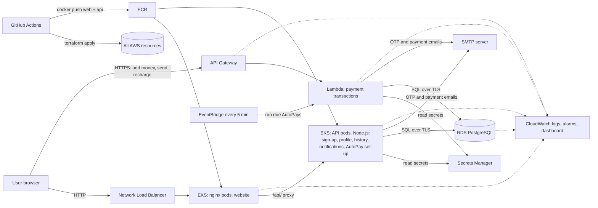

# PayWave - Paytm-style digital wallet on AWS + Kubernetes

A wallet app with **everything created and deployed by one GitHub Actions pipeline**. You provide credentials as GitHub secrets, push to `main`, and the pipeline builds the infrastructure with Terraform, deploys the website **and the API service to Kubernetes (EKS)**, deploys the **payment transactions to AWS Lambda**, and prints the public URL.

Features: sign up with **mobile number** (your payment ID) and email OTP, add money by **credit or debit card** (simulated), send money by mobile number, **QR code to receive** and a **scanner** to pay, **profile photo**, **mobile recharge**, **AutoPay** (daily, weekly, monthly), and a **notification to both sender and receiver on every payment** (in-app bell plus email).



**Who does what.** Kubernetes runs the website (nginx) and the API service (`ROUTE_MODE=core`): `/auth/*`, `/me`, `/lookup`, `/transactions`, `/insights`, `/contacts`, `/profile/*`, `/avatar`, `/notifications*`, `/autopay*`. Lambda runs only the routes that move money (`ROUTE_MODE=payments`): `POST /wallet/add-money`, `POST /wallet/transfer`, `POST /wallet/recharge`, plus the scheduled AutoPay runner. Both use the same code base, database and signing key, so a login token from one is accepted by the other. The browser calls `/api/...` (same origin, proxied by nginx to the API pods) and calls API Gateway directly for payments (`PAYMENTS_API_URL` in `config.js`).

| Technology | What it does here |
|---|---|
| Terraform | Creates VPC, EKS, RDS, Lambda, API Gateway, EventBridge, S3, ECR (2 repos), IAM, Secrets, CloudWatch (`terraform/`) |
| Kubernetes (EKS) | Website: Deployment x2, Service (NLB). API service: Deployment x2, ClusterIP Service, HPA, PodDisruptionBudget, IRSA service account |
| AWS Lambda + API Gateway | Payment transactions (add money, transfer, recharge) and the 5-minute AutoPay runner |
| Amazon RDS PostgreSQL | Users, wallets, transactions, notifications, AutoPay. Private subnets, encrypted, reachable only from Lambda and the EKS nodes |
| AWS IAM | Least-privilege roles for Lambda and for the API pods (IRSA): each reads exactly 2 secrets |
| Secrets Manager | DB password (RDS-managed, auto-rotated), JWT key and SMTP credentials |
| Amazon S3 | Versioned private bucket with the built frontend/static files |
| CloudWatch | Log groups, 7 alarms to an SNS email topic, one dashboard, EKS control plane logs |
| SMTP | Sign-up verification code and payment notification emails (Gmail, SES, SendGrid, anything SMTP) |
| Prometheus + Grafana | Metrics, dashboards and alert rules on the cluster (`k8s/monitoring/`, Helm `kube-prometheus-stack`) |
| GitHub Actions | `deploy.yml` (full deploy on push), `ci.yml` (PR checks), `destroy.yml` (manual tear down) |

## Deploy in 5 steps

1. **Create a GitHub repository** and push this folder to it (branch `main`).
2. **Create an AWS access key** for an IAM user in a dedicated or sandbox AWS account. `AdministratorAccess` is the simplest, because the pipeline creates VPCs, IAM roles, EKS and more.
3. **Add repository secrets** under *Settings > Secrets and variables > Actions > Secrets*:

   | Secret | Required | Example |
   |---|---|---|
   | `AWS_ACCESS_KEY_ID` | yes | `AKIA...` |
   | `AWS_SECRET_ACCESS_KEY` | yes | |
   | `SMTP_HOST` | for real emails | `smtp.gmail.com` |
   | `SMTP_PORT` | no (default 587) | `587` or `465` |
   | `SMTP_USER` | for real emails | `you@gmail.com` |
   | `SMTP_PASSWORD` | for real emails | Gmail *App Password* (needs 2-step verification) |
   | `SMTP_FROM` | for real emails | `PayWave <you@gmail.com>` |
   | `ALERT_EMAIL` | no | where CloudWatch alarms are sent (confirm the AWS email) |
| `GRAFANA_ADMIN_PASSWORD` | no | Grafana login password for user `admin` (if empty, a random one is generated, see *Monitoring*) |

   Optional variables *(Variables tab)*: `AWS_REGION` (default `us-east-1`), `GRAFANA_ALLOWED_CIDR` (who may open Grafana, default `0.0.0.0/0`, for example `203.0.113.7/32`), `KPS_VERSION` (pin the kube-prometheus-stack Helm chart version).
   Without SMTP secrets the stack still works, but the OTP codes are written to the Lambda CloudWatch log group instead of being emailed (testing only).
4. **Push to `main`** (or run *Actions > Deploy PayWave > Run workflow*). The first run takes about 25-35 minutes (EKS and RDS are slow to create).
5. **Open the job summary**: it shows the website URL (`http://<load-balancer>`), the API URL and the CloudWatch dashboard. Register, enter the emailed code, add money, send money.

What the pipeline does, in order: unit tests (backend and QR code), build the Lambda zip, create the Terraform state bucket (first run), `terraform apply`, build and push the **web and API images** to ECR, sync static files to S3, deploy the API and web pods to EKS, then smoke-test the payments Lambda, the API pods (this also runs the DB migrations) and the website, and finally install **Prometheus + Grafana** on the cluster.

**Push = deploy, destroy = manual.** `deploy.yml` runs on every push to `main` (except Markdown-only changes). `destroy.yml` has only a manual trigger: *Actions > Destroy PayWave > Run workflow*, then type `DESTROY`. It never runs on push.

## Monitoring (Prometheus + Grafana)

The deploy installs the `kube-prometheus-stack` Helm chart into the `monitoring` namespace (`scripts/deploy-monitoring.sh`, values in `k8s/monitoring/`).

- **Prometheus** scrapes the cluster (nodes, pods, kube-state-metrics) and the PayWave API pods, which expose `/metrics` on internal port 9100 (request count, latency histogram, in-flight requests, memory, CPU, event-loop lag). That port is not reachable through the public `/api/` proxy.
- **Grafana** is published on its own load balancer. The job summary shows the URL. Log in as `admin` with the `GRAFANA_ADMIN_PASSWORD` secret; if it is not set, a random password was generated, read it with `kubectl -n monitoring get secret grafana-admin -o jsonpath='{.data.admin-password}' | base64 -d`.
- **Dashboards**: *PayWave API (Kubernetes)* (Prometheus), *PayWave AWS (Lambda, API Gateway, RDS)* (CloudWatch data source, read through an IRSA role with `CloudWatchReadOnlyAccess`), plus the standard Kubernetes dashboards from the chart. Add your own by putting JSON in `k8s/monitoring/dashboards/`.
- **Alert rules** (`k8s/monitoring/rules.yaml`): API down, 5xx above 5%, p95 latency above 1 s, pod restarts. Alertmanager is off, so they show in *Grafana > Alerting*; the emailed alarms remain the CloudWatch ones.
- **No persistent storage**: Prometheus keeps 7 days in memory-backed pod storage, so history resets if the pod restarts. This avoids the EBS CSI driver and leaves nothing behind on destroy.
- Grafana is plain HTTP and public unless you set `GRAFANA_ALLOWED_CIDR`. Restrict it.
- To look at Prometheus itself: `kubectl -n monitoring port-forward svc/monitoring-kube-prometheus-prometheus 9090`.

## Features and how they work

- **Mobile number is the payment ID.** Sign-up asks for an Indian mobile number (10 digits starting 6-9, `+91`/`0` prefixes accepted). It is unique among verified accounts, shown on the balance card (Copy number, Copy pay link) and used to pay: `https://<site>/#pay=9876543210` opens Send with the number filled in. The old `PW...` ID still exists internally (`users.pay_id`) and is accepted by the API. Accounts created before this version are asked to add a number in their profile (it can be set once).
- **Card top-ups (simulated).** The form validates the card (Luhn, expiry, CVV, brand) in the browser and sends only `{brand, kind, last4}` plus the amount. The full number and CVV never leave the browser. Test card `4111 1111 1111 1111`; `4000 0000 0000 0002` simulates a decline. No gateway is called.
- **QR and scanner.** My QR draws a QR code of your pay link (download as PNG, copy, share). The scanner reads codes from the camera (needs HTTPS, or `localhost`) or from a photo/upload (works over plain HTTP; on a phone it opens the camera app). The encoder and decoder are in `frontend/public/qr.js` with no dependencies.
- **Profile photo.** Cropped and resized to 256x256 JPEG in the browser, stored as a small data URL, shown next to your name and in "Send again".
- **Mobile recharge (simulated).** Pick operator, plan or amount (Rs 10 to 3,000); your wallet is debited and a `RECHARGE` transaction is recorded. No operator is contacted.
- **AutoPay.** Schedule a payment to a mobile number or a recharge, daily/weekly/monthly (max 10). EventBridge invokes the Lambda every 5 minutes; due items run with a deterministic idempotency key, so an overlapping or retried run can never pay twice. If the balance is too short the run is skipped, you get a failure notification, and the next date is scheduled. Missed runs are not caught up.
- **Notifications.** Every payment writes an in-app notification for the sender and the receiver in the same database transaction as the money movement, and queues an email to both (sent best-effort after commit; a slow SMTP server never fails a payment). The bell polls every 25 seconds and shows a toast for new items. Recharges, top-ups and AutoPay failures notify you too. Gmail free accounts cap daily sending, and each transfer sends 2 emails.

## Repository layout

```
terraform/   VPC, EKS (+IRSA), RDS, Lambda, API Gateway, EventBridge, S3, ECR, IAM, Secrets, CloudWatch
backend/     API code (src/), SQL migrations, tests, Dockerfile + server.js (Kubernetes), Lambda entry src/index.js
frontend/    Web app (public/: core.js, panels.js, app.js, qr.js), nginx.conf (/api proxy), Dockerfile, QR tests
k8s/         Namespace, web (ConfigMap, Deployment, Service/NLB, HPA, PDB), api.yaml (ServiceAccount, Deployment, ClusterIP Service, HPA, PDB)
k8s/monitoring/  Prometheus + Grafana Helm values, ServiceMonitor, alert rules, dashboards (JSON)
scripts/     build-lambda.sh, bootstrap-state.sh, deploy-k8s.sh, deploy-monitoring.sh, destroy.sh
.github/workflows/   deploy.yml, ci.yml, destroy.yml
docker-compose.yml   Local run: Postgres + mail catcher + API + web
```

## API

All bodies are JSON. Errors look like `{"error":{"code":"INSUFFICIENT_FUNDS","message":"..."}}`.

Where each route runs: **Lambda** = payments, **K8s** = API pods.

| Method and path | Runs on | Auth | Purpose |
|---|---|---|---|
| `GET /health` (`?deep=1` checks the DB) | both | no | Liveness |
| `POST /auth/register` `{fullName,mobile,email,password}` | K8s | no | Creates account, emails a 6 digit code (409 `MOBILE_TAKEN` if the number belongs to a verified account) |
| `POST /auth/verify-otp` `{email,otp}` | K8s | no | Verifies email, returns `{token,user}` |
| `POST /auth/resend-otp` `{email}` | K8s | no | New code (60 s cooldown) |
| `POST /auth/login` `{email,password}` | K8s | no | Returns `{token,user}` (1 hour JWT) |
| `GET /me` | K8s | Bearer | Profile (mobile, avatar) and balance |
| `GET /lookup?to=<mobile>` | K8s | Bearer | Name behind a number, so the sender can confirm before paying |
| `POST /wallet/add-money` `{amount,card:{brand,kind,last4}}` | **Lambda** | Bearer | Card top-up, simulated (Rs 1 to 50,000) |
| `POST /wallet/transfer` `{to,amount,note?}` | **Lambda** | Bearer | Send money by mobile number (Rs 1 to 1,00,000) |
| `POST /wallet/recharge` `{mobile,operator,amount,plan?}` | **Lambda** | Bearer | Mobile recharge, simulated (Rs 10 to 3,000) |
| `GET /transactions?limit=&before=` | K8s | Bearer | History, newest first, cursor paging |
| `GET /insights`, `GET /contacts` | K8s | Bearer | 30 day totals and 7 day series; people you paid recently |
| `POST /profile/mobile`, `POST /profile/avatar`, `POST /profile/avatar/remove`, `GET /avatar?to=` | K8s | Bearer | Set number once; photo upload/removal; read a photo |
| `GET /notifications`, `POST /notifications/read` | K8s | Bearer | List with unread count; mark read |
| `GET /autopay`, `POST /autopay`, `POST /autopay/action` | K8s | Bearer | List, create, pause/resume/cancel |
| *(scheduled)* EventBridge every 5 minutes | **Lambda** | n/a | Runs the due AutoPays |

Money endpoints accept an optional `Idempotency-Key` header, so a retried request never moves money twice.

Safety built in: scrypt password hashes, constant-time comparisons, 5 OTP attempts per code, account lock after 5 failed logins, identical response for registered and unregistered emails, amounts handled as integer paise (no floating point), row locks in a fixed order so opposite transfers cannot deadlock, a CHECK constraint that keeps balances non-negative.

## Run locally

```bash
docker compose up --build
# App http://localhost:8081   API http://localhost:3000/health   Emails http://localhost:8025
# (locally one process serves all routes; in AWS they are split between Kubernetes and Lambda)
cd backend && npm test                  # unit tests, no dependencies needed
node --test frontend/test/*.test.js     # QR encoder/decoder tests
```

## Cost warning

This is a real EKS + NAT + RDS stack. Rough estimate: **about $250-300 per month (~$0.37 per hour)** in `us-east-1`: EKS control plane ~$73, three `t3.medium` nodes ~$90 (a third node was added for Prometheus/Grafana), NAT gateway ~$35, two load balancers (website, Grafana) ~$34, RDS `db.t3.micro` ~$15-20, the rest is small. Run **Actions > Destroy PayWave** (type `DESTROY`) when you are done. The Terraform state bucket (`paywave-tfstate-<account>-<region>`) is kept on purpose; delete it by hand if you want it gone.

## Before this handles real money

This is a working demo, not a licensed payment product.

- **Card top-ups and recharges are simulated.** A real wallet must credit money only after a payment gateway (UPI, cards) confirms it by signed webhook, must call a recharge aggregator for recharges, and in India needs RBI Prepaid Payment Instrument authorisation, KYC and audit controls.
- **Mobile numbers are not verified by SMS.** Someone could register a number that is not theirs before the real owner does. Real products verify by OTP to the number (SMS in India needs DLT registration) before allowing payments to it.
- **The camera scanner needs HTTPS.** Photo/upload scanning works on plain HTTP; live camera does not (browser rule).
- **The website is served over plain HTTP** by the load balancer. Add a domain, an ACM certificate and HTTPS (AWS Load Balancer Controller + Ingress, or CloudFront) and then set `cors_allowed_origin` to that domain.
- Other hardening to consider: AWS WAF on API Gateway, RDS Proxy and Multi-AZ (`db_multi_az = true`), `db_deletion_protection = true`, one NAT gateway per AZ, pinning the RDS CA bundle in `backend/src/db.js`, GitHub OIDC instead of long-lived AWS keys, a private EKS endpoint with a self-hosted runner.
- The pipeline user becomes EKS cluster admin. If you later deploy with a different AWS identity, add it with an EKS access entry.

## Verification status

Checked in the build environment:

- **Backend:** 37 unit tests pass. A full integration run against a real **PostgreSQL 16** (all 3 migrations plus every query) covered: sign-up with mobile and duplicate rejection, card top-up with idempotent replay, transfer by mobile (replay, self-transfer, unknown number, insufficient funds), in-app notifications for both sender and receiver, recharge, history/insights/contacts, profile photo validation, adding a mobile to an old account, AutoPay (due runs, failure handling, no double run, pause/cancel), the scheduled EventBridge event, and a ledger check (wallet totals equal top-ups minus recharges).
- **Frontend:** 8 QR tests pass (round trips for every version and level, rotation, damage repair), the decoder was also checked against OpenCV. A Chromium run with a mock API and the production CSP (no inline styles/scripts) covered sign-up, card top-up, send, QR download (decoded with OpenCV), scanning a QR image, the live camera (fake device), recharge, AutoPay, photo upload, notifications and a phone-sized layout, with zero console or CSP errors, and checked that payments go to the Lambda URL while everything else goes to `/api`.
- All JavaScript, shell scripts, workflows and Kubernetes manifests parse.

**Not run here** (no network, no AWS account, no Terraform binary): `terraform validate/apply`, the Docker builds, the EKS/IRSA/RDS connectivity and the GitHub workflows. Expect to possibly fix small things on the first pipeline run (module or provider version drift, for example). Run `terraform fmt -recursive` once in `terraform/`, and run `npm install` once in `backend/` and commit `package-lock.json` for reproducible builds.
