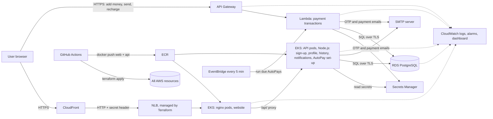

# PayWave - Paytm-style digital wallet on AWS + Kubernetes

A wallet app with **everything created and deployed by one GitHub Actions pipeline**. You provide credentials as GitHub secrets, push to `main`, and the pipeline builds the infrastructure with Terraform, deploys the website **and the API service to Kubernetes (EKS)**, deploys the **payment transactions to AWS Lambda**, and prints the public URL.

Features: sign up with **mobile number** (your payment ID) and email OTP, add money to your wallet **in one tap (no card needed)**, your own **virtual debit and credit card** (used only when you choose to pay someone with a card), send money by mobile number, **QR code to receive** and a **scanner** to pay, **profile photo**, **mobile recharge**, **AutoPay** (daily, weekly, monthly), and a **notification to both sender and receiver on every payment** (in-app bell plus email).



**Who does what.** Kubernetes runs the website (nginx) and the API service (`ROUTE_MODE=core`): `/auth/*`, `/me`, `/lookup`, `/transactions`, `/insights`, `/contacts`, `/profile/*`, `/avatar`, `/notifications*`, `/autopay*`. Lambda runs only the routes that move money (`ROUTE_MODE=payments`): `POST /wallet/add-money`, `POST /wallet/transfer`, `POST /wallet/recharge`, plus the scheduled AutoPay runner. Both use the same code base, database and signing key, so a login token from one is accepted by the other. The browser calls `/api/...` (same origin, proxied by nginx to the API pods) and calls API Gateway directly for payments (`PAYMENTS_API_URL` in `config.js`).

| Technology | What it does here |
|---|---|
| Terraform | Creates VPC, EKS, RDS, Lambda, API Gateway, EventBridge, S3, ECR (2 repos), IAM, Secrets, CloudWatch, AWS Backup (`terraform/`) |
| Kubernetes (EKS) | Website: Deployment x2, NodePort Service (reached through CloudFront; no Kubernetes-created load balancer). API service: Deployment x2, ClusterIP Service, HPA, PodDisruptionBudget, IRSA service account |
| AWS Lambda + API Gateway | Payment transactions (add money, transfer, recharge) and the 5-minute AutoPay runner |
| Amazon RDS PostgreSQL | Users, wallets, transactions, notifications, AutoPay. Private subnets, encrypted, reachable only from Lambda and the EKS nodes. Backed up daily and monthly with AWS Backup, copied to a second region, final snapshot on delete (see *Backup and disaster recovery*) |
| AWS IAM | Least-privilege roles for Lambda and for the API pods (IRSA): each reads exactly 2 secrets |
| Secrets Manager | DB password (RDS-managed, auto-rotated), JWT key and SMTP credentials |
| Amazon S3 | Versioned private bucket with the built frontend/static files |
| CloudWatch | Log groups, 7 alarms to an SNS email topic, one dashboard, EKS control plane logs |
| SMTP | Sign-up verification code and payment notification emails (Gmail, SES, SendGrid, anything SMTP) |
| Prometheus + Grafana | Metrics, dashboards and alert rules on the cluster (`k8s/monitoring/`, Helm `kube-prometheus-stack`) |
| GitHub Actions | `deploy.yml` (full deploy on push), `ci.yml` (PR checks), `destroy.yml` (manual tear down), `otp.yml` (manual: show sign-up codes when SMTP is not set) |

## Deploy in 5 steps

1. **Create a GitHub repository** and push this folder to it (branch `main`).
2. **Create an AWS access key** for an IAM user in a dedicated or sandbox AWS account. `AdministratorAccess` is the simplest, because the pipeline creates VPCs, IAM roles, EKS and more.
3. **Add repository secrets** under *Settings > Secrets and variables > Actions > Secrets*:

   | Secret | Required | Example |
   |---|---|---|
   | `AWS_ACCESS_KEY_ID` | yes | `AKIA...` |
   | `AWS_SECRET_ACCESS_KEY` | yes | |
   | `SMTP_HOST` | for real emails | `smtp.gmail.com` |
   | `SMTP_PORT` | no (default 587) | `587` or `465` |
   | `SMTP_USER` | for real emails | `you@gmail.com` |
   | `SMTP_PASSWORD` | for real emails | Gmail *App Password* (needs 2-step verification) |
   | `SMTP_FROM` | for real emails | `PayWave <you@gmail.com>` |
   | `ALERT_EMAIL` | no | where CloudWatch alarms are sent (confirm the AWS email) |
| `GRAFANA_ADMIN_PASSWORD` | no | Grafana login password for user `admin` (if empty, a random one is generated, see *Monitoring*) |

   Optional variables *(Variables tab)*: `AWS_REGION` (default `us-east-1`), `KPS_VERSION` (kube-prometheus-stack Helm chart version, default `93.6.1`).
   Without SMTP secrets the stack still works, but the sign-up codes (OTP) are not emailed: the API pods write them to their log. Run **Actions > Show sign-up codes > Run workflow** right after you press *Register* to read the latest codes (valid 10 minutes), or `kubectl -n paywave logs -l app=paywave-api | grep OTP`. Testing only; configure SMTP for real use.
4. **Push to `main`** (or run *Actions > Deploy PayWave > Run workflow*). The first run takes about 25-35 minutes (EKS and RDS are slow to create).
5. **Open the job summary**: it shows the app URL (`https://<id>.cloudfront.net`), the API URL and the CloudWatch dashboard. A new CloudFront distribution needs a few minutes to roll out, so the first smoke test can take up to 20 minutes. Register, enter the emailed code, add money, send money.

What the pipeline does, in order: unit tests (backend and QR code), build the Lambda zip, create the Terraform state bucket (first run), `terraform apply`, build and push the **web and API images** to ECR, sync static files to S3, deploy the API and web pods to EKS, then smoke-test the payments Lambda, the API pods (this also runs the DB migrations) and the website, and finally install **Prometheus + Grafana** on the cluster.

Prefer to run it yourself? See **[Manual deployment](#manual-deployment-without-github-actions)** below.

**Push = deploy, destroy = manual.** `deploy.yml` runs on every push to `main` (except Markdown-only changes). `destroy.yml` has only a manual trigger: *Actions > Destroy PayWave > Run workflow*, then type `DESTROY`. It never runs on push.

## Manual deployment (without GitHub Actions)

`deploy.yml` is only a script that runs these same commands on a GitHub server. You can run them yourself from your own computer, in the same order. Use this to learn what each step does, to debug a failed pipeline run, or when you cannot use GitHub Actions. Do not mix the two on one AWS account unless you use the same Terraform state bucket (step 3), otherwise two separate copies of the infrastructure are created.

### 0. What to install

| Tool | Version | Used for |
|---|---|---|
| AWS CLI v2 | any recent | login, S3, ECR, EKS |
| Terraform | 1.11 or newer (the pipeline uses 1.12.2) | creates all AWS resources |
| Node.js and npm | 22 | tests and the Lambda zip |
| Docker | any recent | builds the web and API images |
| kubectl | within one version of the cluster (EKS 1.35) | deploys to Kubernetes |
| Helm | 3 | installs Prometheus + Grafana |
| `envsubst` | from `gettext` (`apt install gettext-base`, `brew install gettext`) | fills the `${NAMES}` in `k8s/*.yaml` |
| `zip`, `curl`, `openssl`, `bash` | | scripts |

Use Linux, macOS or WSL. The scripts are bash.

### 1. Log in to AWS and set the settings

Use an IAM user in a sandbox account (the same kind of key as the pipeline: `AdministratorAccess` is the simplest). The identity that runs `terraform apply` becomes the EKS cluster admin, so use the same one for the whole deployment.

```bash
export AWS_ACCESS_KEY_ID=AKIA...
export AWS_SECRET_ACCESS_KEY=...
export AWS_REGION=us-east-1
export PROJECT_NAME=paywave
export ENVIRONMENT=prod
aws sts get-caller-identity          # must print your account id

# Email settings (optional). Leave SMTP_HOST empty to skip real emails; sign-up codes then go to the pod log (step 9).
export TF_VAR_project_name=$PROJECT_NAME TF_VAR_environment=$ENVIRONMENT TF_VAR_aws_region=$AWS_REGION
export TF_VAR_dr_region=us-west-2       # second region for the backup copy; must differ from AWS_REGION (see Backup and disaster recovery)
export TF_VAR_smtp_host="smtp.gmail.com"  TF_VAR_smtp_port=587
export TF_VAR_smtp_user="you@gmail.com"   TF_VAR_smtp_password="your-app-password"
export TF_VAR_smtp_from="PayWave <you@gmail.com>"
export TF_VAR_alert_email="you@example.com"    # CloudWatch alarm emails (confirm the AWS email)
```

### 2. Run the tests and build the Lambda package

```bash
(cd backend && npm ci && npm test)
node --test frontend/test/*.test.js
bash scripts/build-lambda.sh          # creates backend/dist/lambda.zip
```

Terraform needs `lambda.zip` to exist before it can plan, so do not skip the build.

### 3. Create the Terraform state bucket (first time only)

```bash
bash scripts/bootstrap-state.sh       # prints the bucket name: paywave-tfstate-<account-id>-<region>
export STATE_BUCKET=paywave-tfstate-$(aws sts get-caller-identity --query Account --output text)-$AWS_REGION
```

The script is safe to run again. The bucket keeps Terraform's memory of what exists and a lock file.

### 4. Create all AWS resources with Terraform (25-35 minutes the first time)

```bash
cd terraform
terraform init -input=false \
  -backend-config="bucket=$STATE_BUCKET" \
  -backend-config="key=$PROJECT_NAME/$ENVIRONMENT/terraform.tfstate" \
  -backend-config="region=$AWS_REGION" \
  -backend-config="use_lockfile=true" \
  -backend-config="encrypt=true"
terraform validate
terraform plan -out=tfplan            # read what will be created
terraform apply tfplan                # EKS and RDS are the slow parts
```

This creates the VPC, subnets, NAT, EKS, RDS, Lambda, API Gateway, EventBridge, CloudFront, the NLB, S3, ECR, IAM, Secrets Manager and CloudWatch. Then read the results into shell variables for the next steps:

```bash
export API_URL=$(terraform output -raw api_url)
export CLUSTER_NAME=$(terraform output -raw eks_cluster_name)
export ECR_URL=$(terraform output -raw ecr_repository_url)
export ECR_API_URL=$(terraform output -raw ecr_backend_repository_url)
export FRONTEND_BUCKET=$(terraform output -raw frontend_bucket)
export API_POD_ROLE_ARN=$(terraform output -raw api_pod_role_arn)
export DB_HOST=$(terraform output -raw db_host)
export DB_USER=$(terraform output -raw db_user)
export DB_NAME=$(terraform output -raw db_name)
export DB_SECRET_ARN=$(terraform output -raw db_secret_arn)
export APP_SECRET_ARN=$(terraform output -raw app_secret_arn)
export GRAFANA_ROLE_ARN=$(terraform output -raw grafana_role_arn)
export CLOUDFRONT_DOMAIN=$(terraform output -raw cloudfront_domain)
export ORIGIN_VERIFY=$(terraform output -raw origin_verify_secret)   # secret: do not paste it anywhere
cd ..
```

### 5. Build the two images and push them to ECR

```bash
aws ecr get-login-password --region $AWS_REGION | docker login --username AWS --password-stdin "${ECR_URL%%/*}"
TAG=$(git rev-parse --short=12 HEAD 2>/dev/null || date +%Y%m%d%H%M)    # any unique tag
export IMAGE="$ECR_URL:$TAG"  API_IMAGE="$ECR_API_URL:$TAG"

docker build --platform linux/amd64 -t "$IMAGE"     -t "$ECR_URL:latest"     frontend   # website (nginx)
docker build --platform linux/amd64 -t "$API_IMAGE" -t "$ECR_API_URL:latest" backend    # API (Node.js)
docker push "$IMAGE";     docker push "$ECR_URL:latest"
docker push "$API_IMAGE"; docker push "$ECR_API_URL:latest"
```

`--platform linux/amd64` matters on Apple Silicon, because the EKS servers are x86.

### 6. Copy the static files to S3

```bash
rm -rf /tmp/site && mkdir -p /tmp/site && cp -r frontend/public/. /tmp/site/
printf 'window.APP_CONFIG = {\n  API_BASE_URL: "/api",\n  PAYMENTS_API_URL: "%s",\n};\n' "$API_URL" > /tmp/site/config.js
aws s3 sync /tmp/site "s3://$FRONTEND_BUCKET/site/" --delete
```

This is a versioned copy of the release. The website you open is served by the nginx pods, which have the same files inside the image.

### 7. Deploy the app to Kubernetes

```bash
export PAYMENTS_API_URL="$API_URL"
export LOG_OTP_WITHOUT_SMTP=$([ -z "${TF_VAR_smtp_host:-}" ] && echo true || echo false)
bash scripts/deploy-k8s.sh
```

The script points `kubectl` at the cluster, installs metrics-server, deploys the API pods first (their start-up runs the database migrations), creates the secret nginx uses to accept only CloudFront traffic, then deploys the web pods. If it fails, it prints the pod status and logs.

### 8. Check that everything answers

```bash
curl -fsS "$API_URL/health?deep=1"                      # payments API (Lambda) + database
curl -fsS "https://$CLOUDFRONT_DOMAIN/healthz"          # website through CloudFront
curl -fsS "https://$CLOUDFRONT_DOMAIN/api/health?deep=1" # API pods through nginx
kubectl -n paywave get pods
```

A new CloudFront distribution can take up to 20 minutes to reach every edge location, so retry the last two commands a few times. Then open `https://$CLOUDFRONT_DOMAIN`.

### 9. Sign-up codes without SMTP

If you set no SMTP values, read the 6 digit code from the API pod log right after pressing *Register* (valid 10 minutes):

```bash
kubectl -n paywave logs -l app=paywave-api --tail=200 | grep -i otp
```

### 10. Install Prometheus + Grafana (optional, about 10 minutes)

```bash
export GRAFANA_ADMIN_PASSWORD='choose-a-strong-password'   # optional; if unset a random one is created
bash scripts/deploy-monitoring.sh                          # prints the Grafana address; user: admin
kubectl -n monitoring get secret grafana-admin -o jsonpath='{.data.admin-password}' | base64 -d; echo   # the generated password
```

### Updating after a code change

- **Website or API code:** repeat step 5 with a new `TAG`, step 6, then step 7 (it rolls the pods to the new image).
- **Payments (Lambda) code:** repeat step 2 (`build-lambda.sh`), then `terraform apply` in step 4. Terraform only replaces the function when the zip content changed.
- **Infrastructure:** edit `terraform/*.tf` and run `terraform plan` then `terraform apply`.

### Tearing everything down

```bash
bash scripts/destroy.sh               # removes Grafana, the app namespace, then runs terraform destroy
```

Run it from a shell where steps 1 and 4 (`terraform init`) were done in `terraform/`, and where `backend/dist/lambda.zip` exists (`touch backend/dist/lambda.zip` is enough). The state bucket is kept on purpose; delete it by hand if you want it gone:

```bash
aws s3 rb "s3://$STATE_BUCKET" --force   # also removes all stored versions only if versioning cleanup is done, see the AWS docs
```

### If something goes wrong

| Symptom | What to check |
|---|---|
| `terraform init` cannot find the bucket | Step 3 not run, or `AWS_REGION` differs from the one used for the bucket |
| `terraform plan` says the zip file is missing | Run `bash scripts/build-lambda.sh` |
| `kubectl` says unauthorized | Use the same AWS identity that ran `terraform apply`, or add yours as an EKS access entry |
| Pods `ImagePullBackOff` | The images were not pushed, or were built for the wrong CPU type (use `--platform linux/amd64`) |
| Website returns 403 | You called the load balancer directly. Use the CloudFront address; only it sends the secret header |
| CloudFront returns 502 or 504 right after deploy | Wait a few minutes; the load balancer is still finding healthy servers |
| `envsubst: command not found` | Install `gettext` |

## Resource names in the AWS console

Everything Terraform creates is named `paywave-prod-<what-it-is>` (`<project>-<environment>-...`). Resources that show a **Name** column (EC2, VPC) carry a `Name` tag, and every resource also has a `Purpose` tag explaining what it does. Filter any console page by `paywave-prod`.

| Console | Name you will see | What it is |
|---|---|---|
| VPC | `paywave-prod-vpc` | The network |
| VPC > Subnets | `paywave-prod-public-<az>`, `-private-<az>`, `-database-<az>` | Load balancer + NAT, nodes + Lambda, database |
| VPC | `paywave-prod-igw`, `-nat`, `-nat-eip` | Internet gateway, NAT gateway and its IP |
| VPC > Route tables | `paywave-prod-public-rt`, `-private-rt`, `-database-rt` | Routing |
| EC2 > Security groups | `paywave-prod-lambda-sg`, `-rds-sg`, `-eks-cluster-sg`, `-eks-nodes-sg` | Firewalls |
| EC2 > Instances | `paywave-prod-node` (x3) | EKS worker nodes |
| EC2 > Load balancers | `paywave-prod-web` / target group `paywave-prod-web` | NLB for the web pods |
| EKS | `paywave-prod` / node group `paywave-prod-nodes` | Kubernetes cluster |
| CloudFront | comment `paywave-prod web app` (Name tag `paywave-prod-web-cdn`) | Public HTTPS entry |
| API Gateway | `paywave-prod-api` (stage `prod`) | Payments REST API |
| Lambda | `paywave-prod-api` | Payments + AutoPay function |
| EventBridge | `paywave-prod-autopay` | Runs AutoPay every 5 minutes |
| RDS | `paywave-prod-pg` | PostgreSQL database |
| S3 | `paywave-prod-frontend-<account-id>` | Frontend files |
| ECR | `paywave-prod-frontend`, `paywave-prod-backend` | Container images |
| Secrets Manager | `paywave-prod/app-config`, `paywave-prod/jwt-key-backup` | DB login, JWT key |
| IAM > Roles | `paywave-prod-lambda`, `-apigw-cloudwatch`, `-api-pod`, `-grafana`, `-backup`, `-eks-cluster-role`, `-eks-node-role` | Permissions per component |
| SNS | `paywave-prod-alerts`, `paywave-prod-backup-events` | Email alerts |
| CloudWatch > Alarms | `paywave-prod-lambda-errors`, `-lambda-throttles`, `-lambda-slow`, `-api-5xx`, `-rds-cpu`, `-rds-free-storage`, `-rds-connections` | Alarms |
| CloudWatch > Dashboards | `paywave-prod` | Main dashboard |
| CloudWatch > Log groups | `/aws/lambda/paywave-prod-api`, `/aws/apigateway/paywave-prod-access`, `/aws/eks/paywave-prod/cluster` | Logs |
| AWS Backup | vault `paywave-prod-vault`, plan `paywave-prod-db`; DR vault `paywave-prod-vault-dr` | Backups |

The `-pg`, `-api` and secret names are used by the dashboards, `scripts/destroy.sh` and the commands in this README, so they are left unchanged.

## Backup and disaster recovery

All user data (accounts, balances, the ledger, notifications, AutoPay) is in the RDS database. Everything else is rebuilt from Git, Terraform and ECR, so the database is what gets backed up. Terraform (`terraform/backup.tf`, `rds.tf`) sets up four layers, with nothing to switch on:

| Layer | What it does | Default |
|---|---|---|
| RDS automated backups | Continuous log backup, so you can restore to any second inside the window (point-in-time recovery) | 14 days (`db_backup_retention_days`, 1 to 35) |
| AWS Backup, daily | A snapshot at 19:30 UTC (01:00 IST) into the vault `paywave-prod-vault` | kept 35 days (`backup_retention_days`) |
| AWS Backup, monthly | A snapshot on the 1st of each month | kept 365 days (`backup_monthly_retention_days`) |
| Disaster recovery copy | Every AWS Backup snapshot is copied to a second region, vault `paywave-prod-vault-dr` | on, `us-west-2` (`enable_dr_copy`, `dr_region`) |
| Final snapshot + deletion protection | A snapshot is taken when the database is deleted and is **kept after `destroy`**; deletion protection blocks deleting it by mistake in the console or CLI | on (`db_skip_final_snapshot = false`, `db_deletion_protection = true`) |

The backup vaults and the SNS topic `paywave-prod-backup-events` email `ALERT_EMAIL` when a backup or a copy fails and when a restore finishes (confirm the AWS subscription email).

Good to know:
- **Recovery targets:** point-in-time recovery loses at most a few minutes of data; a restore from a daily snapshot loses up to 24 hours; a region loss restored from the DR copy loses up to 24 hours.
- **Restores never overwrite.** A restore always creates a **new** database from the backup. You then point the app at it (below).
- **`destroy` deletes the vaults and their backups** (`force_destroy`), because a destroy means "remove everything". The RDS **final snapshot stays**, so you can still bring the data back. Delete it by hand when you really do not want it.
- **Pipeline users:** the AWS user needs permission in the DR region too (`AdministratorAccess` has it). If your main region is `us-west-2`, the pipeline uses `us-east-1` as the DR region automatically; set the repository variable `DR_REGION` to choose another.
- Cost: AWS Backup snapshot storage and the cross-region copy are billed per GB; for a small database that is a few dollars a month.
- **Key to save:** the database backup alone is not enough for card data; see *The one secret you must keep* below.
- **Not covered:** this protects against deleted or damaged data, a failed database and a lost region. It is not a licensed bank-grade DR plan, and a restore has not been tried on this project yet. **Do a test restore (below) once before you rely on it.**

### Restore options

Pick the case that matches what went wrong. Replace `paywave-prod` if you changed the names, and run the commands from your own shell with the same AWS login.

**A. Someone deleted or corrupted data an hour ago (point-in-time recovery).** Restore a copy of the database as it was just before the mistake, then read the good rows out of it.

```bash
aws rds restore-db-instance-to-point-in-time \
  --source-db-instance-identifier paywave-prod-pg \
  --target-db-instance-identifier paywave-prod-pg-restored \
  --restore-time 2026-11-27T05:30:00Z \
  --db-subnet-group-name $(aws rds describe-db-instances --db-instance-identifier paywave-prod-pg \
      --query 'DBInstances[0].DBSubnetGroup.DBSubnetGroupName' --output text) \
  --vpc-security-group-ids $(aws rds describe-db-instances --db-instance-identifier paywave-prod-pg \
      --query 'DBInstances[0].VpcSecurityGroups[0].VpcSecurityGroupId' --output text) \
  --no-publicly-accessible
aws rds wait db-instance-available --db-instance-identifier paywave-prod-pg-restored
```

The new instance has its own address (`aws rds describe-db-instances --db-instance-identifier paywave-prod-pg-restored --query 'DBInstances[0].Endpoint.Address'`). Connect from a pod (`kubectl -n paywave run psql --rm -it --image=postgres:16 -- psql -h <address> -U paywave_admin paywave`), check the data, and copy the rows you need back with `pg_dump`/`psql`. Delete the restored instance when you are done. The time is UTC.

**B. The database is lost or broken: restore the whole database from a snapshot with Terraform.**

1. Find a snapshot. The most recent AWS Backup snapshots are RDS snapshots named `awsbackup:job-...`; a destroy leaves `paywave-prod-pg-final-<id>`:

   ```bash
   aws rds describe-db-snapshots --snapshot-type awsbackup \
     --query 'reverse(sort_by(DBSnapshots,&SnapshotCreateTime))[].[DBSnapshotIdentifier,SnapshotCreateTime]' --output table
   aws rds describe-db-snapshots --snapshot-type manual \
     --query 'DBSnapshots[?contains(DBSnapshotIdentifier,`final`)].[DBSnapshotIdentifier,SnapshotCreateTime]' --output table
   ```

2. Replace the database from that snapshot, from the `terraform/` folder (after `terraform init`, see *Manual deployment*, step 4):

   ```bash
   # the database is deleted and recreated from the snapshot; it takes a final snapshot of the damaged one first
   terraform apply -replace=aws_db_instance.this -var 'db_snapshot_identifier=awsbackup:job-XXXX'
   ```

   With the pipeline, add the secret/variable the same way: set `TF_VAR_db_snapshot_identifier` in the `Terraform apply` step of `deploy.yml` for one run, then remove it. The new database keeps the same name (`paywave-prod-pg`) but has a new address, so afterwards **re-run the deploy** (or steps 4 to 7 of *Manual deployment*) so the API pods and Lambda pick up the new `DB_HOST` and password secret.

3. Check `curl -fsS "$API_URL/health?deep=1"` and sign in.

**C. The whole region is lost (disaster recovery).** The DR vault in the second region holds copies of the snapshots.

1. In the DR region, find the newest snapshot and note its name:

   ```bash
   aws rds describe-db-snapshots --region us-west-2 --snapshot-type awsbackup \
     --query 'reverse(sort_by(DBSnapshots,&SnapshotCreateTime))[0].DBSnapshotIdentifier' --output text
   ```

2. Read the key copy (see *The one secret you must keep*), then deploy PayWave in that region from the same repository: set the repository variable `AWS_REGION` to the DR region (and `DR_REGION` to another region), then run the deploy once with `TF_VAR_jwt_secret` and `TF_VAR_db_snapshot_identifier` set to the snapshot name from step 1 (a manual run works the same: `export AWS_REGION=us-west-2` and follow *Manual deployment* with that variable). This builds the whole stack there and loads your data. It takes the same 25 to 35 minutes as a first deploy.
3. The address changes (a new `*.cloudfront.net`), so tell users the new link. A custom domain would let you switch with a DNS change instead.

### The one secret you must keep: the encryption key

Card numbers and CVVs in the database are encrypted with the app's key (`jwt_secret`, generated once by Terraform and kept in Secrets Manager and in the Terraform state). It also signs login tokens and hashes the sign-up codes. **A database backup is only readable for cards if you still have this key.** A new deployment generates a *new* key, so restoring a snapshot into a fresh stack without the old key leaves existing cards unreadable (accounts, balances and history still work; people would have to be issued new cards).

- **Normal case (restore in the same stack, option A or B):** nothing to do, the key is unchanged.
- **Region lost (option C):** a copy of the key is kept for you in the DR region as the secret `paywave-prod/jwt-key-backup`. Read it there and pass it to the new deploy:

  ```bash
  export TF_VAR_jwt_secret=$(aws secretsmanager get-secret-value --region us-west-2 \
      --secret-id paywave-prod/jwt-key-backup --query SecretString --output text)
  ```

- **After a `destroy`:** the key is deleted with the stack, so a rebuild from the final snapshot cannot recover it. **Save the key once, now, somewhere safe** (a password manager, not Git):

  ```bash
  aws secretsmanager get-secret-value --secret-id paywave-prod/app-config --query SecretString --output text | jq -r .jwt_secret
  ```

  To rebuild from the final snapshot later, pass that value as `TF_VAR_jwt_secret` together with `TF_VAR_db_snapshot_identifier`. In the pipeline, store the saved key as a repository secret named `JWT_SECRET` (the *Terraform apply* step already passes it; leave the secret unset for normal deploys).

**Test it once.** In a spare moment run option A with a `--restore-time` from a few hours ago, connect, count the rows in `users` and `transactions`, then delete the test instance (`aws rds delete-db-instance --db-instance-identifier paywave-prod-pg-restored --skip-final-snapshot`). A backup you have never restored is only a hope.

## Monitoring (Prometheus + Grafana)

The deploy installs the `kube-prometheus-stack` Helm chart into the `monitoring` namespace (`scripts/deploy-monitoring.sh`, values in `k8s/monitoring/`).

- **Prometheus** scrapes the cluster (nodes, pods, kube-state-metrics) and the PayWave API pods, which expose `/metrics` on internal port 9100 (request count, latency histogram, in-flight requests, memory, CPU, event-loop lag). That port is not reachable through the public `/api/` proxy.
- **Grafana has its own AWS load balancer** (a Network Load Balancer, plain HTTP). After the deploy, open the job summary (*Actions > the run > Summary > Monitoring (Grafana)*): it shows the Grafana address `http://<name>.elb.<region>.amazonaws.com`, the user `admin` and the password (your `GRAFANA_ADMIN_PASSWORD` secret, or a generated one printed there, so keep the repository private). A brand-new load balancer needs 2-5 minutes before the address answers.
- **Dashboards** (Grafana left menu > Dashboards > folder **PayWave**). The number in each name tells you the order to look at them:

  | Dashboard | What it monitors | Data from |
  |---|---|---|
  | **1. Website and API Health (Kubernetes)** | Are the website API pods up, requests per second, failed requests, response time, memory/CPU of each API pod, restarts | Prometheus |
  | **2. Payments, Lambda, API Gateway and Database (AWS)** | Money transfers, card top-ups, recharge and AutoPay (Lambda calls, errors, time), the API Gateway front door, the PostgreSQL database (CPU, connections, free disk) | CloudWatch (IRSA role with `CloudWatchReadOnlyAccess`) |
  | **3. Servers and Pods (Kubernetes cluster)** | CPU, memory, disk and network of the EKS servers, how many pods run, pods stuck Pending | Prometheus |

  Every dashboard starts with a "What am I looking at?" box, and hovering the small *i* on a panel explains it and says what a healthy value is. The standard Kubernetes dashboards from the chart are also there. Add your own JSON in `k8s/monitoring/dashboards/`.
- **Alert rules** (`k8s/monitoring/rules.yaml`): API down, 5xx above 5%, p95 latency above 1 s, pod restarts. Alertmanager is off, so they show in *Grafana > Alerting*; the emailed alarms remain the CloudWatch ones.
- **No persistent storage**: Prometheus keeps 7 days in memory-backed pod storage, so history resets if the pod restarts. This avoids the EBS CSI driver and leaves nothing behind on destroy.
- If monitoring fails to install, the deploy still succeeds (the app is live); you get a warning and can re-run the workflow.
- Grafana is reachable from the internet over plain HTTP behind its login. Set a strong `GRAFANA_ADMIN_PASSWORD` secret, and keep the repository private if you let the pipeline generate the password. If Grafana does not open: check the *Deploy monitoring* step log (it prints pod status and events on failure) and that the `monitoring-grafana` Service has an external hostname (`kubectl -n monitoring get svc monitoring-grafana`).
- To look at Prometheus itself: `kubectl -n monitoring port-forward svc/monitoring-kube-prometheus-prometheus 9090`.

## Features and how they work

- **Mobile number is the payment ID.** Sign-up asks for an Indian mobile number (10 digits starting 6-9, `+91`/`0` prefixes accepted). It is unique among verified accounts, shown on the balance card (Copy number, Copy pay link) and used to pay: `https://<site>/#pay=9876543210` opens Send with the number filled in. The old `PW...` ID still exists internally (`users.pay_id`) and is accepted by the API. Accounts created before this version are asked to add a number in their profile (it can be set once).
- **Add money needs no card.** *Add money* asks for an amount only (with ₹500 / ₹1,000 / ₹2,000 / ₹5,000 quick buttons) and credits your own wallet. It is simulated: no gateway is called and nothing is charged to anyone.
- **Your own debit and credit card.** Every account gets two virtual cards, issued when the email is verified (existing accounts get them the first time they open *My cards* or *Send*). The **debit card** spends your wallet balance. The **credit card** has a ₹25,000 limit; spending raises the amount you owe, and *Pay bill* repays it from the wallet. Numbers are 16 digits and pass the Luhn check, the expiry is 5 years out, and the 3 digit CVV is random. The full number and CVV are encrypted in the database (AES-256-GCM, key derived from the app secret) and are shown only after you re-enter your password, hiding again after 30 seconds. You can freeze and unfreeze a card (unfreezing needs the password), and five wrong CVVs in a row freeze it. They are demo cards: no real card network is involved.
- **Card details are asked for only when you pay a person with a card.** *Send* defaults to **Wallet** and asks for nothing extra. If you pick the debit or credit card, you enter that card's CVV. The CVV is checked on the server before any money moves; a credit card payment cannot exceed the available limit, even with many payments at once (card rows are locked before wallet rows, so there are no deadlocks).
- **QR and scanner.** My QR draws a QR code of your pay link (download as PNG, copy, share). The scanner reads codes from the camera (needs HTTPS, or `localhost`) or from a photo/upload (works over plain HTTP; on a phone it opens the camera app). The encoder and decoder are in `frontend/public/qr.js` with no dependencies.
- **Profile photo.** Cropped and resized to 256x256 JPEG in the browser, stored as a small data URL, shown next to your name and in "Send again".
- **Mobile recharge (simulated).** Pick operator, plan or amount (Rs 10 to 3,000); your wallet is debited and a `RECHARGE` transaction is recorded. No operator is contacted.
- **AutoPay.** Schedule a payment to a mobile number or a recharge, daily/weekly/monthly (max 10). EventBridge invokes the Lambda every 5 minutes; due items run with a deterministic idempotency key, so an overlapping or retried run can never pay twice. If the balance is too short the run is skipped, you get a failure notification, and the next date is scheduled. Missed runs are not caught up.
- **Notifications.** Every payment writes an in-app notification for the sender and the receiver in the same database transaction as the money movement, and queues an email to both (sent best-effort after commit; a slow SMTP server never fails a payment). The bell polls every 25 seconds and shows a toast for new items. Recharges, top-ups and AutoPay failures notify you too. Gmail free accounts cap daily sending, and each transfer sends 2 emails.

## Repository layout

```
terraform/   VPC, EKS (+IRSA), RDS, Lambda, API Gateway, EventBridge, CloudFront + NLB, S3, ECR, IAM, Secrets, CloudWatch
backend/     API code (src/), SQL migrations, tests, Dockerfile + server.js (Kubernetes), Lambda entry src/index.js
frontend/    Web app (public/: core.js, panels.js, app.js, qr.js), nginx.conf (/api proxy), Dockerfile, QR tests
k8s/         Namespace, web (ConfigMap, Deployment, NodePort Service, HPA, PDB), api.yaml (ServiceAccount, Deployment, ClusterIP Service, HPA, PDB)
k8s/monitoring/  Prometheus + Grafana Helm values, ServiceMonitor, alert rules, dashboards (JSON)
scripts/     build-lambda.sh, bootstrap-state.sh, deploy-k8s.sh, deploy-monitoring.sh, destroy.sh
.github/workflows/   deploy.yml, ci.yml, destroy.yml
docker-compose.yml   Local run: Postgres + mail catcher + API + web
```

## API

All bodies are JSON. Errors look like `{"error":{"code":"INSUFFICIENT_FUNDS","message":"..."}}`.

Where each route runs: **Lambda** = payments, **K8s** = API pods.

| Method and path | Runs on | Auth | Purpose |
|---|---|---|---|
| `GET /health` (`?deep=1` checks the DB) | both | no | Liveness |
| `POST /auth/register` `{fullName,mobile,email,password}` | K8s | no | Creates account, emails a 6 digit code (409 `MOBILE_TAKEN` if the number belongs to a verified account) |
| `POST /auth/verify-otp` `{email,otp}` | K8s | no | Verifies email, returns `{token,user}` |
| `POST /auth/resend-otp` `{email}` | K8s | no | New code (60 s cooldown) |
| `POST /auth/login` `{email,password}` | K8s | no | Returns `{token,user}` (1 hour JWT) |
| `GET /me` | K8s | Bearer | Profile (mobile, avatar) and balance |
| `GET /lookup?to=<mobile>` | K8s | Bearer | Name behind a number, so the sender can confirm before paying |
| `POST /wallet/add-money` `{amount}` | **Lambda** | Bearer | Add money to your own wallet, no card (Rs 1 to 50,000, simulated) |
| `GET /cards` | Kubernetes | Bearer | Your debit and credit card (masked), credit limit and amount owed |
| `POST /cards/reveal` `{kind,password}` | Kubernetes | Bearer | Full number, expiry and CVV (password re-check) |
| `POST /cards/status` `{kind,frozen,password?}` | Kubernetes | Bearer | Freeze or unfreeze a card (unfreeze needs the password) |
| `POST /cards/repay` `{amount}` | **Lambda** | Bearer | Pay the credit card bill from the wallet |
| `POST /wallet/transfer` `{to,amount,note?}` | **Lambda** | Bearer | Send money by mobile number (Rs 1 to 1,00,000) |
| `POST /wallet/recharge` `{mobile,operator,amount,plan?}` | **Lambda** | Bearer | Mobile recharge, simulated (Rs 10 to 3,000) |
| `GET /transactions?limit=&before=` | K8s | Bearer | History, newest first, cursor paging |
| `GET /insights`, `GET /contacts` | K8s | Bearer | 30 day totals and 7 day series; people you paid recently |
| `POST /profile/mobile`, `POST /profile/avatar`, `POST /profile/avatar/remove`, `GET /avatar?to=` | K8s | Bearer | Set number once; photo upload/removal; read a photo |
| `GET /notifications`, `POST /notifications/read` | K8s | Bearer | List with unread count; mark read |
| `GET /autopay`, `POST /autopay`, `POST /autopay/action` | K8s | Bearer | List, create, pause/resume/cancel |
| *(scheduled)* EventBridge every 5 minutes | **Lambda** | n/a | Runs the due AutoPays |

Money endpoints accept an optional `Idempotency-Key` header, so a retried request never moves money twice.

Safety built in: scrypt password hashes, constant-time comparisons, 5 OTP attempts per code, account lock after 5 failed logins, identical response for registered and unregistered emails, amounts handled as integer paise (no floating point), row locks in a fixed order so opposite transfers cannot deadlock, a CHECK constraint that keeps balances non-negative.

## Run locally

```bash
docker compose up --build
# App http://localhost:8081   API http://localhost:3000/health   Emails http://localhost:8025
# (locally one process serves all routes; in AWS they are split between Kubernetes and Lambda)
cd backend && npm test                  # unit tests, no dependencies needed
node --test frontend/test/*.test.js     # QR encoder/decoder tests
```

## Cost warning

This is a real EKS + NAT + RDS stack. Rough estimate: **about $235-285 per month (~$0.35 per hour)** in `us-east-1`: EKS control plane ~$73, three `t3.medium` nodes ~$90 (a third node was added for Prometheus/Grafana), NAT gateway ~$35, one NLB behind CloudFront ~$17 and one NLB for Grafana ~$17 (CloudFront itself is ~free at demo traffic), RDS `db.t3.micro` ~$15-20, the rest is small. Run **Actions > Destroy PayWave** (type `DESTROY`) when you are done. The Terraform state bucket (`paywave-tfstate-<account>-<region>`) and the database's final snapshot are kept on purpose; delete it by hand if you want it gone.

## Before this handles real money

This is a working demo, not a licensed payment product.

- **Add money, the virtual cards and recharges are simulated.** A real wallet must credit money only after a payment gateway (UPI, cards) confirms it by signed webhook, must call a recharge aggregator for recharges, and in India needs RBI Prepaid Payment Instrument authorisation, KYC and audit controls.
- **Mobile numbers are not verified by SMS.** Someone could register a number that is not theirs before the real owner does. Real products verify by OTP to the number (SMS in India needs DLT registration) before allowing payments to it.
- **The camera scanner needs HTTPS.** Photo/upload scanning works on plain HTTP; live camera does not (browser rule).
- **The address is a `*.cloudfront.net` name.** It is HTTPS already (CloudFront's certificate). For your own domain, add an ACM certificate in `us-east-1` and an alias on the distribution, then set `cors_allowed_origin` to that domain. The load balancer behind CloudFront is plain HTTP inside AWS and refuses any request that lacks CloudFront's secret header.
- Other hardening to consider: AWS WAF on API Gateway, RDS Proxy and Multi-AZ (`db_multi_az = true`), one NAT gateway per AZ, pinning the RDS CA bundle in `backend/src/db.js`, GitHub OIDC instead of long-lived AWS keys, a private EKS endpoint with a self-hosted runner.
- The pipeline user becomes EKS cluster admin. If you later deploy with a different AWS identity, add it with an EKS access entry.

## Verification status

Tested in a sandbox (no AWS account was available there):

- **Backend:** 43 unit tests pass. A full run against a real **PostgreSQL 16**, with the Kubernetes-mode and the Lambda-mode API side by side, passed 41 checks: card issue (Luhn-valid numbers, encrypted at rest), password-protected reveal, add money with no card, sending from the wallet with no card, debit and credit card payments (wrong, missing and right CVV, idempotent replay), credit limit, freeze/unfreeze, auto-freeze after 5 wrong CVVs, bill payment, history, existing accounts getting cards on first visit, **10 parallel credit payments against the limit (exactly the right number succeed)**, a mixed parallel run with no deadlocks, and ledger checks. Migration 004 was also applied on top of a database with migrations 001-003 and existing rows.
- **Frontend:** 8 QR tests pass. The real web app code was driven in a simulated browser (jsdom) against the real backend: add money with no card fields, the Cards panel (masked, reveal with password, hide), Send defaulting to Wallet with the CVV field appearing only when a card is chosen, a credit card payment, paying the bill, and the history, with zero JavaScript errors.
- **nginx:** the real `nginx.conf` was run: direct requests without CloudFront's secret header get 403 (a wrong header and a suffix trick too), `/healthz` stays open, `/api` is proxied.
- **Kubernetes:** all manifests, including the Prometheus ServiceMonitor and alert rules, pass strict schema validation (kubeconform). Shell scripts pass ShellCheck.
- **Backup and recovery:** the Terraform in `backup.tf` and the changes in `rds.tf`, the restore commands in this README and `scripts/destroy.sh` were written from the AWS provider documentation and **have not been applied or restored against a real AWS account**. Run the test restore in *Backup and disaster recovery* once after your first deploy, and restoring a snapshot with Terraform (option B) once before you depend on it.
- **Terraform:** formatted and parsed; the module outputs and provider arguments used by `cloudfront.tf` were checked against the module source and the AWS provider docs. **`terraform apply`, the Docker builds and Helm were not run (the Grafana chart version falls back to the newest chart if the pinned one does not exist)**, so the first pipeline run is the real test of CloudFront, the NLB, the Grafana chart and cluster networking.

- **UI (v9, "stage" landing page):** a cream-to-lilac gradient stage with a giant PAYWAVE headline behind a phone mockup, floating glass notification chips, dark pill buttons, a glass sign-up card, a centred top nav (How it works, Features, Questions), glass cards and a pastel balance card on the dashboard, and a deep-purple dark mode. Rendered in Chromium with the strict Content-Security-Policy in light, dark and phone width with zero console errors.
